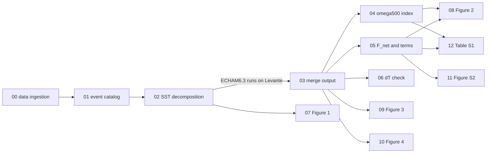

# Pipeline map

`04` and `05` append columns to `data/complete_wc_analysis.csv` (per event and run) and
`data/complete_climatology.csv` (control run); `08`, `11` and `12` read only those two tables.
`09` and `10` read the merged model output directly and use the same control-run window
(`CLIM_PERIOD`) as `04`/`05`, so the maps and the box-mean statistics share one baseline.

## Where each number in the paper comes from

| Manuscript statement | Source | Value in this repository |
|---|---|---|
| 23 events, 10 El Niño and 13 La Niña, \|DJF\| ≥ 0.5 K | `01`, Step 5 | 23 / 10 / 13 |
| Representative events ("very strong" El Niño / La Niña) | `01`, Step 6 | 1983 (2.41 °C), 1989 (−1.87 °C, "Strong") |
| Fig. 2a FULL vs UNIFORM + PATTERN | `08`, Step 2, panel a | slope 1.03 ± 0.02, r² = 0.994 |
| Fig. 2b FULL vs PATTERN | `08`, Step 2, panel b | slope 1.00 ± 0.01, r² = 0.996 |
| Fig. 2c FULL ω vs PATTERN F_net | `08`, Step 2, panel c | slope **+0.67** ± 0.04, r² = 0.929 |
| UNIFORM Walker response "almost zero" (Figure S1) | `08`, Step 4 | δω between −0.018 and +0.032 (FULL: −0.90 to +0.22) |
| Walker response ~67 % from energy input, ~33 % from stability | `08`, panel c | 0.67 = slope of Fig. 2c; 0.33 = 1 − slope, i.e. the part not explained by energy input under the bulk relation ω500,E−W ≈ F_net,W−E / M |
| Tropical-mean SST anomaly of the strongest El Niño | `02` → `data/` `sst_mean_input`; Table S1 (`12`) | 0.25 °C (1983), 0.55 °C (1998) |

Regression statistics with 95 % confidence intervals: `figures/fig2_regression_stats.csv`.
